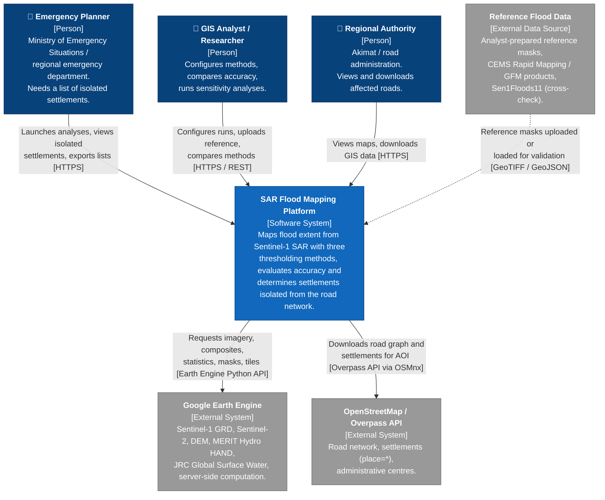
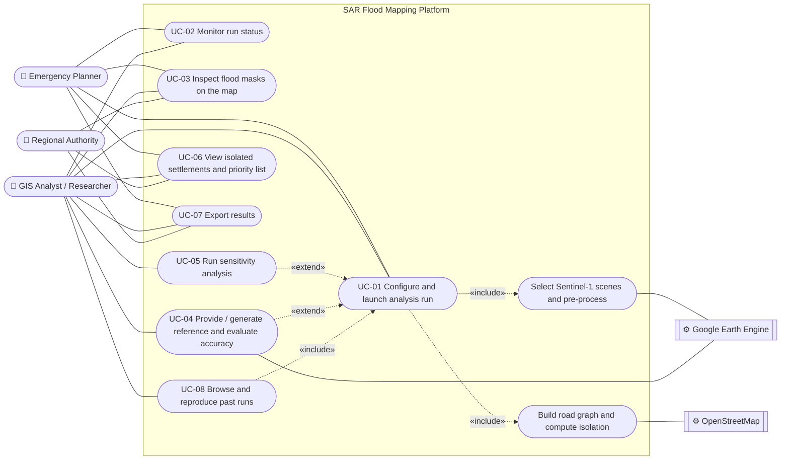
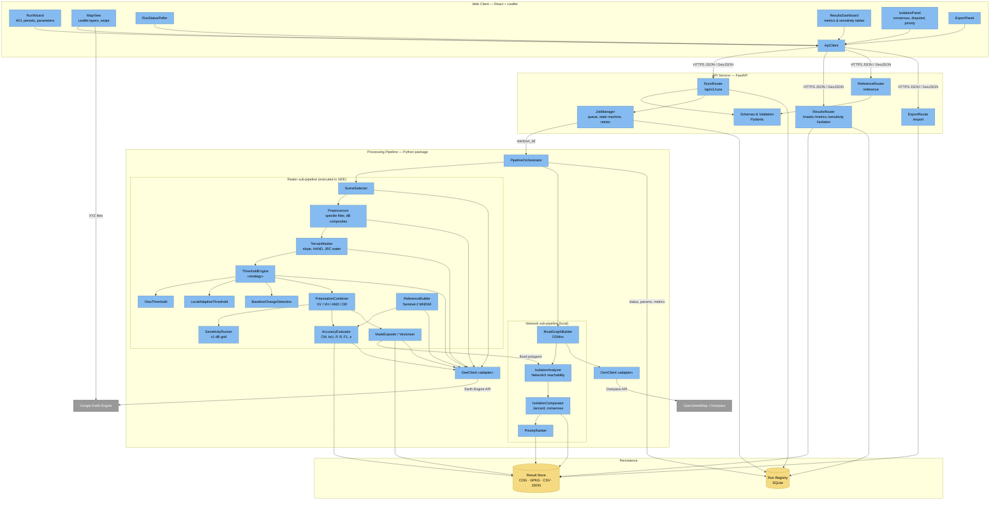
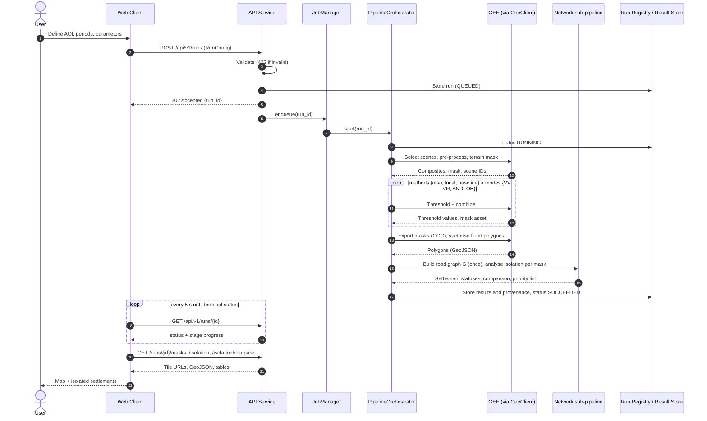
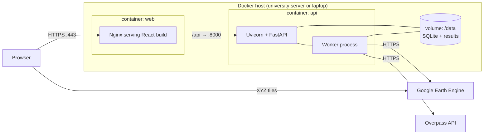

# 07. Architecture and Diagrams

---

## 1. Architectural Overview

The SAR Flood Mapping Platform is a **three-tier web application with an asynchronous processing pipeline**:

1. **Web Client** — a React + Leaflet single-page application in which users configure analyses, follow their progress and inspect maps, metrics and isolated settlements.
2. **API Service** — a FastAPI application that validates requests, manages runs as asynchronous jobs, and serves results.
3. **Processing Pipeline** — a Python package that orchestrates (a) raster processing in Google Earth Engine (scene selection, pre-processing, masking, three thresholding methods, polarisation logic, sensitivity grid, accuracy metrics) and (b) local network analysis with OSMnx/NetworkX (road graph, isolation, comparison).

Results are stored as files (Cloud-Optimized GeoTIFF, GeoPackage, CSV) plus GEE assets, with run metadata in an SQLite **Run Registry** (TD-3).

### 1.1 Architectural drivers

| Driver | Requirement(s) | Architectural response |
|--------|---------------|------------------------|
| Long-running cloud computations (minutes) | FR-16, NFR-01, NFR-12 | Asynchronous job pattern: `POST /runs` → `202` + `run_id`; background worker; polling (TD-5) |
| Identical conditions for all methods | FR-03, NFR-05, RQ | One `PipelineOrchestrator` computes shared inputs (composites, terrain mask, road graph) **once per run** and passes them to every method |
| Comparability and extensibility of methods | FR-04 … FR-07 | **Strategy pattern**: `ThresholdMethod` interface with `Otsu`, `LocalAdaptive`, `BaselineChange` implementations |
| Vendor lock-in to GEE | TD-1 | **Adapter**: all Earth Engine calls isolated in `GeeClient`; algorithm logic also implemented in NumPy for unit tests |
| Reproducibility | NFR-05 | Every run stores parameters, scene IDs, OSM extract timestamp, software version and output hashes |
| Interoperability | FR-19, NFR-11 | Standard formats (COG, GeoJSON, GeoPackage, CSV) with sidecar metadata |
| Simple deployment | NFR-07 | Two containers (web, api+worker) in Docker Compose; no database server |

### 1.2 Architectural style and patterns

- **Layered architecture** within the backend: API layer → application services (JobManager, Orchestrator) → domain modules (processing) → infrastructure adapters (GeeClient, OsmClient, repositories).
- **Pipes-and-filters** for the processing chain (select → pre-process → mask → threshold → combine → evaluate → vectorise → isolate → compare).
- **Strategy** for thresholding methods; **Adapter** for external services; **Repository** for result storage (allows a later PostGIS migration without API change).

---

## 2. Diagram 1 — System Context Diagram (C4 Level 1)

The context diagram shows the platform as a single system, its users and the external systems it depends on.

### 2.1 Context elements

| Element | Type | Responsibility / data exchanged | Related requirements |
|---------|------|-------------------------------|--------------------|
| Emergency Planner | Person | Configures a run with default parameters; reads isolated-settlement list and map | UC-01, UC-02, UC-06, UC-07; NFR-10 |
| GIS Analyst / Researcher | Person | Full configuration, reference upload, sensitivity analysis, method comparison | UC-01 … UC-08 |
| Regional Authority | Person | Read-only viewing and export | UC-03, UC-06, UC-07 |
| Google Earth Engine | External system | Data catalogue and raster computation; returns statistics, assets and XYZ tile URLs | FR-02 … FR-10 |
| OpenStreetMap / Overpass | External system | Road and settlement vector data | FR-11 |
| Reference flood data | External data | Ground truth for accuracy assessment | FR-09, FR-10, FR-22 |

---

## 3. Diagram 2 — Use Case Diagram

### 3.1 Use case descriptions

| ID | Use case | Primary actor | Pre-condition | Main success scenario | Post-condition | Requirements |
|----|----------|--------------|---------------|-----------------------|---------------|-------------|
| **UC-01** | Configure and launch analysis run | Emergency Planner, GIS Analyst | Platform running; GEE credentials configured | 1. User draws/uploads AOI. 2. Selects pre-flood period and post-flood window. 3. (Analyst) selects methods, polarisation modes, mask parameters, hubs. 4. Submits. 5. System validates and returns `run_id`. 6. Pipeline selects scenes, pre-processes, masks, applies three methods, builds road graph, computes isolation. | Run stored with status `SUCCEEDED` or `FAILED`/`NO_DATA` | FR-01 … FR-07, FR-11, FR-12, FR-15, FR-16 |
| **UC-02** | Monitor run status | All | Run exists | User opens run; UI polls status and stage progress; on completion results become available | User informed of result or error | FR-16, NFR-12 |
| **UC-03** | Inspect flood masks on the map | All | Run `SUCCEEDED` | User toggles masks per method/mode/offset, reference and flooded roads; optional swipe comparison | — | FR-17, FR-21 |
| **UC-04** | Provide / generate reference and evaluate accuracy | GIS Analyst | Run `SUCCEEDED` | 1. Analyst uploads reference mask **or** requests Sentinel-2 candidate (±2 days). 2. Reviews and confirms it. 3. System computes confusion matrix, IoU, precision, recall, F1, κ for all masks. | Metrics stored and displayed | FR-09, FR-10, FR-18, FR-22 |
| **UC-05** | Run sensitivity analysis | GIS Analyst | Run `SUCCEEDED` | Analyst requests ±1 dB grid; system generates up to 36 masks and tabulates area and metrics | Sensitivity table stored | FR-08, FR-18 |
| **UC-06** | View isolated settlements and priority list | All | Run `SUCCEEDED` | User opens isolation panel; sees counts per method, consensus/disputed lists, ranked priority list; clicks a settlement for details | — | FR-12, FR-13, FR-14, FR-17, NFR-15 |
| **UC-07** | Export results | All | Run `SUCCEEDED` | User chooses product (mask COG, polygons/settlements GeoJSON/GPKG, tables CSV) and downloads | File with run metadata delivered | FR-19, NFR-11 |
| **UC-08** | Browse and reproduce past runs | GIS Analyst | ≥ 1 stored run | User lists runs, opens one, triggers "re-run" | New run with identical parameters | FR-20, NFR-05 |

---

## 4. Container View (C4 Level 2 — supporting)

Before the component diagram, the containers of the system are summarised.

| Container | Technology | Responsibility | Communicates with |
|-----------|-----------|----------------|------------------|
| **Web Client** | React, react-leaflet, TypeScript | UI for UC-01 … UC-08; map rendering of GEE XYZ tiles and GeoJSON | API Service (HTTPS, JSON/GeoJSON); GEE tile servers (XYZ tiles) |
| **API Service** | Python 3.11, FastAPI, Uvicorn | REST endpoints, validation, job management, result delivery | Processing Worker (in-process task queue), Run Registry, Result Store |
| **Processing Worker** | Python, Earth Engine API, OSMnx, NetworkX, GeoPandas, Rasterio | Executes the pipeline for a run | GEE (Earth Engine API), OSM (Overpass), Result Store, Run Registry |
| **Run Registry** | SQLite | Run configurations, status, stage progress, metrics, parameters | API Service, Worker |
| **Result Store** | File volume: COG, GeoPackage, CSV, JSON + GEE assets | Persisted outputs per `run_id` | API Service, Worker |

The API Service and Processing Worker run in the same container image but in separate processes, so the worker can later be moved to Celery + Redis without changing the REST contract (TD-5).

---

## 5. Diagram 3 — Component Diagram (draft, C4 Level 3)

### 5.1 Component responsibilities

| Component | Responsibility | Inputs → Outputs | Requirements |
|-----------|---------------|------------------|-------------|
| **RunWizard** | Collects AOI, periods, method/mode/mask parameters, hubs | User input → `RunConfig` JSON | FR-01, FR-17 |
| **MapView** | Displays AOI, masks, reference, flooded roads, settlements; swipe view | Tile URLs, GeoJSON → map | FR-17, FR-21 |
| **RunStatusPoller** | Polls run status and stage progress | `run_id` → status | FR-16 |
| **ResultsDashboard** | Metrics and sensitivity tables, sorting | API JSON → tables | FR-18 |
| **IsolationPanel** | Counts per method, consensus/disputed lists, priority list | API JSON → lists | FR-13, FR-14, NFR-15 |
| **ExportPanel** | Download of products | `run_id`, product type → file | FR-19 |
| **RunsRouter** | `POST /runs`, `GET /runs`, `GET /runs/{id}`, `POST /runs/{id}/rerun` | — | FR-01, FR-15, FR-16, FR-20 |
| **ResultsRouter** | `GET /runs/{id}/masks`, `/metrics`, `/sensitivity`, `/isolation`, `/isolation/compare` | — | FR-15, FR-17, FR-18 |
| **ReferenceRouter** | `POST /runs/{id}/reference` (upload), `POST /runs/{id}/reference/sentinel2` | — | FR-09, FR-10 |
| **ExportRouter** | `GET /runs/{id}/export/{product}` | — | FR-19 |
| **Schemas & Validation** | Geometry validity, AOI size ≤ 50,000 km², date logic, parameter ranges | Request → validated model or 422 | FR-01, NFR-08 |
| **JobManager** | Queues runs; state machine `QUEUED→RUNNING→SUCCEEDED/FAILED/NO_DATA`; retries with back-off; 60-min time-out | `run_id` → status updates | FR-16, NFR-12 |
| **PipelineOrchestrator** | Executes stages in order; computes shared inputs once; records parameters, scene IDs, hashes | `RunConfig` → stage results | NFR-05, FR-03 |
| **SceneSelector** | Finds S1 GRD IW VV+VH scenes for both periods, matching orbit/pass | AOI, dates → scene list | FR-02 |
| **Preprocessor** | Speckle filter, median composites in dB | Scenes → pre/post composites | FR-02 |
| **TerrainMasker** | Slope > 5°, HAND > 15 m, JRC occurrence ≥ 80 % | DEM, HAND, JRC → valid-pixel mask | FR-03 |
| **ThresholdEngine** + strategies | Computes thresholds and binary water per polarisation via `OtsuThreshold`, `LocalAdaptiveThreshold`, `BaselineChangeDetection` | Composites, mask, offset Δ → thresholds, binary images | FR-04, FR-05, FR-06 |
| **PolarisationCombiner** | Builds VV, VH, AND, OR masks | Binary images → 4 masks per method | FR-07 |
| **SensitivityRunner** | Iterates Δ ∈ {−1, 0, +1} dB over methods and modes | → up to 36 masks, area table | FR-08 |
| **ReferenceBuilder** | Sentinel-2 MNDWI candidate reference within ±2 days, cloud masking | AOI, SAR date → reference candidate | FR-10 |
| **AccuracyEvaluator** | Confusion matrix and metrics over common valid area | Mask, reference → metrics | FR-09, NFR-04 |
| **MaskExporter / Vectoriser** | Exports COG; converts masks to flood polygons | Masks → COG, polygons | FR-19, FR-12 |
| **RoadGraphBuilder** | Downloads drivable graph (AOI + 10 km), settlements, hubs; snaps settlements | AOI → graph **G**, settlements | FR-11 |
| **IsolationAnalyzer** | Removes edges intersecting flood polygons (10 m buffer), computes reachability to hubs, classifies settlements | **G**, polygons → statuses | FR-12, NFR-02 |
| **IsolationComparator** | Counts, pairwise Jaccard, consensus/disputed lists | Status sets → comparison | FR-13 |
| **PriorityRanker** | Ranks isolated settlements | Statuses, attributes → ranked list | FR-14 |
| **GeeClient** | Single gateway to Earth Engine (auth, retries, quotas) | — | TD-1, NFR-12 |
| **OsmClient** | Single gateway to Overpass via OSMnx; caching of extracts | — | FR-11, NFR-05 |
| **Run Registry** | Persists run config, status, metrics, provenance | — | FR-16, FR-20, NFR-05 |
| **Result Store** | Persists output files per `run_id` | — | FR-19, NFR-11 |

---

## 6. Data Flow — Main Scenario (UC-01 → UC-06)

---

## 7. Data Model (logical)

| Entity | Key attributes | Stored in |
|--------|---------------|-----------|
| **Run** | `run_id`, created_at, status, stage, progress, error, software_version | Run Registry |
| **RunConfig** | AOI (GeoJSON), pre_period, post_window, methods[], modes[], offsets[], slope_max, hand_max, jrc_min, tile_size, hubs[] | Run Registry (JSON) |
| **SceneRef** | scene_id, date, relative_orbit, pass_direction, period (pre/post) | Run Registry |
| **MaskResult** | run_id, method, mode, offset_db, threshold_vv, threshold_vh, flooded_area_km2, asset_id, cog_path, sha256 | Run Registry + Result Store |
| **Reference** | run_id, source (upload / S2 / CEMS / GFM), acquisition_date, gap_days, path | Run Registry + Result Store |
| **Metrics** | mask_id, TP, FP, FN, TN, iou, precision, recall, f1, kappa, excluded_pixels | Run Registry |
| **Settlement** | osm_id, name, place_class, population (nullable), geometry, nearest_node, snap_distance_m | Result Store (GPKG) |
| **SettlementStatus** | mask_id, osm_id, status (`isolated`/`inundated`/`connected`/`no_road_access`), removed_edges, low_confidence | Result Store (GPKG/CSV) |
| **IsolationComparison** | run_id, pair (mask_a, mask_b), jaccard, consensus[], disputed[] | Result Store (JSON/CSV) |

---

## 8. Deployment View

GEE service-account credentials are mounted as a secret into the `api` container (NFR-08); nothing sensitive is committed to the repository.

---

## 9. Alignment and Traceability

### 9.1 Requirements → components → use cases

| Requirement | Components | Use case |
|------------|-----------|----------|
| FR-01 AOI and periods | RunWizard, RunsRouter, Schemas & Validation | UC-01 |
| FR-02 S1 retrieval / pre-processing | SceneSelector, Preprocessor, GeeClient | UC-01 |
| FR-03 Terrain / permanent-water mask | TerrainMasker | UC-01 |
| FR-04 Otsu | ThresholdEngine → OtsuThreshold | UC-01, UC-03 |
| FR-05 Local adaptive | ThresholdEngine → LocalAdaptiveThreshold | UC-01, UC-03 |
| FR-06 Baseline change detection | ThresholdEngine → BaselineChangeDetection | UC-01, UC-03 |
| FR-07 Polarisation logic | PolarisationCombiner | UC-01, UC-03 |
| FR-08 Sensitivity | SensitivityRunner, ResultsDashboard | UC-05 |
| FR-09 Accuracy | AccuracyEvaluator, ReferenceRouter, ResultsDashboard | UC-04 |
| FR-10 Sentinel-2 reference | ReferenceBuilder, ReferenceRouter | UC-04 |
| FR-11 Road graph | RoadGraphBuilder, OsmClient | UC-01 |
| FR-12 Isolation | MaskExporter/Vectoriser, IsolationAnalyzer | UC-01, UC-06 |
| FR-13 Isolation comparison | IsolationComparator, IsolationPanel | UC-06 |
| FR-14 Priority list | PriorityRanker, IsolationPanel | UC-06 |
| FR-15 REST API | All routers | All |
| FR-16 Async runs | JobManager, RunStatusPoller, Run Registry | UC-01, UC-02 |
| FR-17 Map | MapView | UC-03, UC-06 |
| FR-18 Dashboard | ResultsDashboard, ResultsRouter | UC-04, UC-05 |
| FR-19 Export | ExportRouter, ExportPanel, Result Store | UC-07 |
| FR-20 Run history | RunsRouter, Run Registry | UC-08 |
| FR-21 Swipe view | MapView | UC-03 |
| FR-22 GFM comparison | ReferenceRouter, AccuracyEvaluator | UC-04 |
| NFR-01 / NFR-02 Performance | GeeClient (server-side), IsolationAnalyzer (in-memory), Orchestrator (shared inputs) | — |
| NFR-05 Reproducibility | PipelineOrchestrator, Run Registry | UC-08 |
| NFR-07 Deployability | Deployment view (Docker Compose) | — |
| NFR-12 Reliability | JobManager, GeeClient, OsmClient | UC-02 |

Every functional requirement is realised by at least one component and exercised by at least one use case; every use case is backed by at least one Must requirement.

### 9.2 Research questions → data produced

| Research element | Produced by | Stored as |
|-----------------|------------|-----------|
| RQ / H1 (accuracy, precision per method) | ThresholdEngine → AccuracyEvaluator | Metrics |
| SQ1 / H3 (±1 dB, AND/OR) | SensitivityRunner → AccuracyEvaluator | Sensitivity table |
| H2 / SQ2 (isolation counts, agreement) | IsolationAnalyzer → IsolationComparator | IsolationComparison |

---

## 10. Architectural Risks and Decisions Pending

| Item | Description | Handling |
|------|-------------|----------|
| GEE time-outs for large AOIs | Interactive `getInfo` calls may time out | Use batch exports for masks; tile AOI; NFR-12 retries |
| Raster → vector conversion size | Flood polygons for large AOIs can be large | Simplify polygons (tolerance ≤ 10 m) before intersection; process per road-graph tile |
| Hub definition | Choice of hubs affects isolation | Configurable hub list; default administrative centres (assumption A-4, validated with users) |
| ADRs | Each TD-1 … TD-6 decision is to be recorded as an ADR in `docs/adr/` | Planned |
