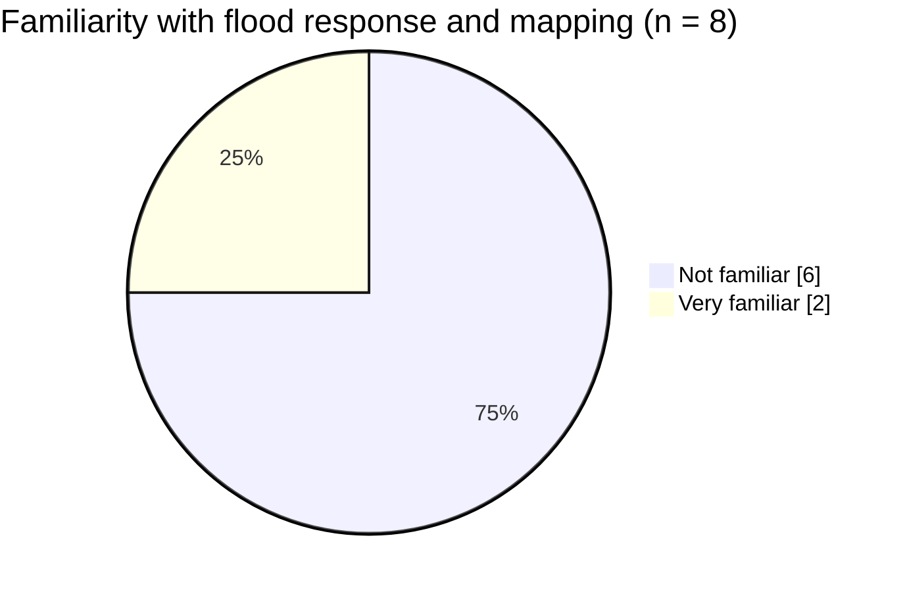
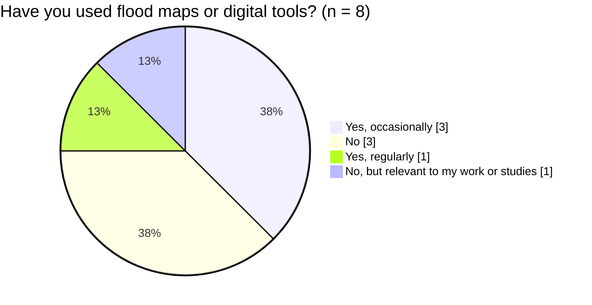
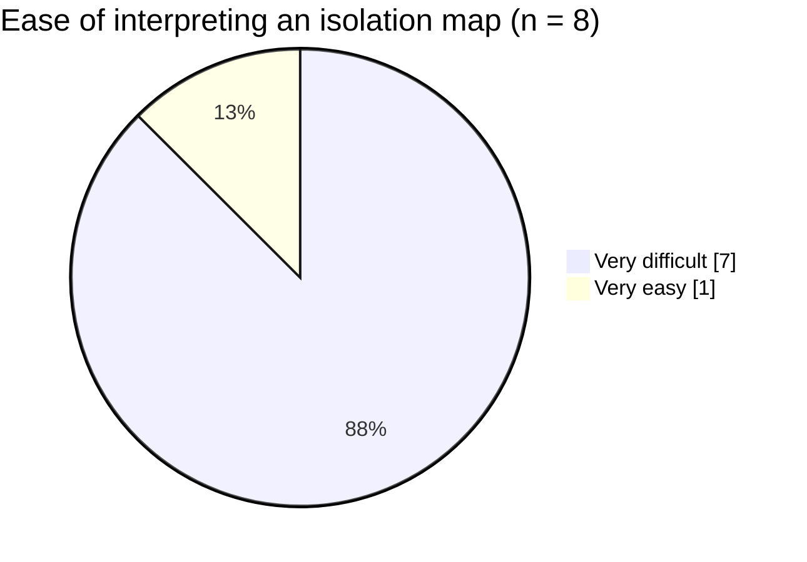

# Evidence of Relevance: User Needs Survey and Public Reports

## 1. Purpose and Approach

This document records the evidence that the problem addressed by the SAR Flood Mapping Platform is real and that the planned outputs match what users need. Two kinds of evidence are used and kept apart:

1. **Primary evidence — a user needs survey** ("Flood Mapping and Settlement Isolation: User Needs Survey", Google Forms) that the team designed and ran. It asked potential users how they assess floods, which outputs they find useful, what would make them distrust a satellite-based map, and how readable a settlement-isolation map is for them.
2. **Supporting evidence — public reports and official statements** on the 2024 spring floods in Kazakhstan.

Structured interviews with emergency-service staff were not feasible within the project timeframe: the 2024 floods were a fast-moving emergency and access to operational decision-makers was limited. The survey was therefore used as the first round of user evidence. **Its limits are stated in Section 5 and must be read together with the results.**

## 2. Survey Design and Respondents

| Item | Value |
| --- | --- |
| Instrument | Google Forms questionnaire (closed questions plus two open-ended questions) |
| Responses | **8** (n = 8; every percentage below is a share of these 8 respondents) |
| Topics | Respondent profile · past use of flood maps and tools · usefulness of information types · most useful outputs · importance of image date · reasons to distrust satellite maps · ease of reading an isolation map · what the tool should explain · one improvement |

### 2.1 Who answered

Role question (respondents could appear in more than one group, so shares add up to more than 100 %):

| Role | Responses | Share | Chart |
| --- | ---: | ---: | --- |
| Student or academic researcher | 6 | 75 % | `████████████░░░░` |
| Local or regional government | 2 | 25 % | `████░░░░░░░░░░░░` |
| Disaster risk / humanitarian aid | 1 | 12.5 % | `██░░░░░░░░░░░░░░` |
| Emergency response / civil protection | 0 | 0 % | `░░░░░░░░░░░░░░░░` |
| GIS, remote sensing or mapping | 0 | 0 % | `░░░░░░░░░░░░░░░░` |
| Other / prefer not to say | 0 | 0 % | `░░░░░░░░░░░░░░░░` |

Familiarity with flood response, flood mapping or disaster planning:

Past use of maps or digital tools to assess flood impacts or access to settlements:

**Reading:** the sample is mostly students and academic researchers (75 %), three quarters of the sample are not familiar with flood response, and half have used flood maps or tools at least occasionally. There were **no respondents from emergency response or from GIS / remote sensing**.

## 3. Results

### 3.1 Which outputs are most useful (choose up to 3)

| Output | Responses | Share | Chart |
| --- | ---: | ---: | --- |
| Affected road segments | 6 | 75 % | `████████████░░░░` |
| Comparison between dates | 5 | 62.5 % | `██████████░░░░░░` |
| List / map of potentially isolated settlements | 4 | 50 % | `████████░░░░░░░░` |
| Downloadable map or report | 4 | 50 % | `████████░░░░░░░░` |
| Map of likely flooded areas | 3 | 37.5 % | `██████░░░░░░░░░░` |
| Explanation of uncertainty | 3 | 37.5 % | `██████░░░░░░░░░░` |
| Other | 0 | 0 % | `░░░░░░░░░░░░░░░░` |

### 3.2 How important is it to know when the satellite image was captured?

| Answer | Responses | Share | Chart |
| --- | ---: | ---: | --- |
| Essential | 8 | 100 % | `████████████████` |
| Not important | 0 | 0 % | `░░░░░░░░░░░░░░░░` |

### 3.3 What would make users hesitate to rely on a satellite-based flood or isolation map? (multiple answers)

| Reason | Responses | Share | Chart |
| --- | ---: | ---: | --- |
| Results may be out of date | 6 | 75 % | `████████████░░░░` |
| Road or settlement data may be unreliable | 4 | 50 % | `████████░░░░░░░░` |
| Training would be needed to interpret the map | 4 | 50 % | `████████░░░░░░░░` |
| Water detection may be inaccurate | 3 | 37.5 % | `██████░░░░░░░░░░` |
| The map may not explain uncertainty | 2 | 25 % | `████░░░░░░░░░░░░` |
| Result would need local verification | 2 | 25 % | `████░░░░░░░░░░░░` |
| Other | 0 | 0 % | `░░░░░░░░░░░░░░░░` |

### 3.4 How easy is it to interpret a map that marks settlements as potentially isolated when their mapped road connections cross detected flood areas?

| Answer | Responses | Share | Chart |
| --- | ---: | ---: | --- |
| Very difficult | 7 | 87.5 % | `██████████████░░` |
| Very easy | 1 | 12.5 % | `██░░░░░░░░░░░░░░` |

### 3.5 Usefulness of information types when assessing a flood

| Rating | Responses | Share | Chart |
| --- | ---: | ---: | --- |
| Moderately useful | 6 | 75 % | `████████████░░░░` |
| Very useful | 2 | 25 % | `████░░░░░░░░░░░░` |

### 3.6 Open-ended answers

Two questions were open (5 answers each): *"What would you want the tool to explain before acting on an isolation result?"* and *"What one change would make this kind of tool more useful for your work or studies?"*

| Theme | What respondents said (paraphrased from the answers) |
| --- | --- |
| Which roads and settlements are affected | "Which roads and settlements are affected, why they may be isolated, and how reliable the result is." |
| How the damage is assessed | "How the damage is assessed." Methodology, data recency and confidence or uncertainty of the water detection were the other points raised in the form's answer summary. |
| Live information and alternatives | An interactive map with real-time flood updates and alternative routes "to help people make faster decisions". |
| Forecasts and historical context | "Flood predictions in near regions"; historical flood data. |
| Ground-truth validation | Checking flood extent and road accessibility against local reports or sensors (from the form's answer summary). |

**Data-quality note:** at least one answer to each open question concerns an unrelated topic (cyber-incident handling) and was **excluded** from the analysis. Results that rely only on the form's automatic answer summary are marked as such.

## 4. Key Findings

| # | Finding | Evidence |
| --- | --- | --- |
| F1 | **The age of the satellite image is essential information.** Users also worry most that results are out of date. | 8 of 8 rate image date as essential; 6 of 8 (75 %) hesitate because results may be out of date |
| F2 | **An isolation map is hard to read without help.** | 7 of 8 (87.5 %) find it very difficult; 4 of 8 (50 %) would need training |
| F3 | **Users want the consequences for roads, not only the water polygon.** | Affected road segments is the top output (6 of 8, 75 %); isolated settlements list/map 50 % |
| F4 | **Comparison between dates and downloadable results are valued.** | Date comparison 5 of 8 (62.5 %); downloadable map or report 4 of 8 (50 %) |
| F5 | **Trust depends on data quality and on explained uncertainty.** | Doubts about road/settlement data 50 %; water-detection accuracy 37.5 %; unexplained uncertainty 25 %; local verification 25 % |
| F6 | **Users want an explanation with the result:** what is affected, why it is isolated and how reliable it is. | Open-ended answers (Section 3.6) |

## 5. Limitations of the Survey Evidence

| Limitation | Consequence |
| --- | --- |
| **Small sample (n = 8)** | Percentages describe these respondents only; no statistical generalisation. One respondent equals 12.5 percentage points. |
| **Mostly students and academics (75 %); no emergency-response and no GIS respondents** | The results reflect the view of **non-expert users**. They are good evidence for readability and explanation needs, but **not** evidence of what emergency services require operationally. |
| **Self-selected respondents** | Possible bias towards people interested in the topic. |
| **Some answers off-topic** | Excluded from the analysis (Section 3.6). |
| **Option labels shortened** | Some option labels were truncated in the form's results view; they are shortened here without changing their meaning. |

## 6. What the Survey Means for the Project

| Finding | Effect on the platform | Related requirement (`05_requirements.md`) |
| --- | --- | --- |
| F1 Image date essential | Show the Sentinel-1 acquisition date and time next to every result and in every export | FR-02 (scene list), FR-17 (map), FR-19 (export) — acceptance criterion to be added |
| F2 Map hard to read | Plain-language explanation of each status, legend, tooltips describing each method | NFR-10 (usability), FR-18 |
| F3 Road consequences wanted | Flooded road segments as a map layer and in results, with the isolated-settlement list | FR-11, FR-12, FR-17 |
| F4 Date comparison, downloads | Downloads are covered; **multi-date comparison is not yet a requirement** | FR-19; candidate new requirement (Could) |
| F5 Trust and uncertainty | Consensus/disputed flags, low-confidence flags, accuracy metrics shown with results, data-quality notes (OSM completeness) | NFR-15, FR-09, FR-13 |
| Open answers: real-time updates, forecasts | Outside the project scope: the platform maps observed floods from Sentinel-1 and does not forecast; update frequency is limited by the satellite revisit time | Out of scope (`01_project_proposal.md`) |
| Open answers: alternative routes | Possible extension of the isolation analysis (routes around flooded segments) | Future work |

## 7. Supporting Evidence from Public Reports

The relevance of focusing on *settlement isolation* rather than only on flood extent is supported by verifiable facts about the 2024 flood event:

* **Verified Finding 1 — Settlements were cut off.** ACAPS (23 April 2024) reports that by 19 April flooding restricted access to **44 settlements** because of damaged roads and bridges; more than 60 road overflows, 63 washouts and ten collapsed bridges were recorded, about 118,200 people were evacuated and the state of emergency covered 10 of 17 regions. International media reported even higher counts of cut-off settlements at other dates, so figures depend on the date of the report. This supports the premise that responders need to know *which communities are isolated*, not only where the water is.
* **Verified Finding 2 — Critical infrastructure damage.** Official statements from local authorities (for example the Akimat of Atyrau Region) reported more than 27.9 km of roads and 6 bridges destroyed or submerged in that region alone. Road-network disruption is a primary consequence of the floods, which justifies using OpenStreetMap road graphs for isolation assessment.
* **Verified Finding 3 — Delayed relief.** Witness accounts and news reports from affected areas (for example Kulsary) describe rescue and aid teams struggling to reach villages because access routes were flooded. This shows the operational need for a rapid, automated tool that identifies isolation zones.

## 8. Verified Findings and Assumptions

| Statement | Status | Basis |
| --- | --- | --- |
| Settlements were cut off by flooding in 2024 and road damage was severe | **Verified** | ACAPS; official statements; media reports |
| Users need to know the capture date of the satellite image | **Verified for the surveyed group** | 8 of 8 respondents (Section 3.2) |
| Isolation maps are hard to interpret without explanation | **Verified for the surveyed group (mostly non-experts)** | 7 of 8 find it very difficult (Section 3.4) |
| Users want affected roads and isolated settlements as outputs | **Verified for the surveyed group** | Section 3.1 |
| Emergency responders need a SAR-based web platform and can interpret SAR-based isolation maps | **Assumption — not yet tested with emergency staff** | No emergency-response respondents; survey results suggest explanations will be needed |
| The main bottleneck of current workflows is manual threshold selection | **Assumption — supported by literature, not by users** | Amoah (2026); Khanh & Le (2026); no GIS respondents in the survey |

## 9. Planned Follow-up

* Hold 3–5 short structured conversations with representatives of the target groups (local or regional government, civil protection, GIS analysts). The survey respondents from local government and from the humanitarian sector are natural first contacts.
* Test the explanation layer (tooltips, legend, plain-language statuses) with the same respondents and record the result in the usability test (`07_verification_plan.md`, UAT).
* Keep verified findings and assumptions separated, as in Section 8, as new evidence arrives.

## 10. Conclusion

Public reports confirm that road-network disruption isolated settlements during the 2024 floods in Kazakhstan, and the user survey shows that potential users want road-level consequences, need to know how current a result is, and find an unexplained isolation map hard to read. The platform therefore adds explanation, image dates and uncertainty information to the isolation results. The survey is small and consists mostly of non-expert respondents, so it supports the usability requirements but does **not** replace conversations with emergency-service staff, which are planned (Section 9).

## References

* ACAPS. (2024, April 23). *Kazakhstan: Floods* (Briefing note). https://www.acaps.org/fileadmin/Data_Product/Main_media/20240423_ACAPS_briefing_note_Kazakhstan_floods.pdf
* Amoah, G. O. (2026). Cloud-independent flood mapping and surface water dynamics using Sentinel-1 SAR in the Lower Volta Basin, Ghana. *Geomatica, 78*, 100131. https://doi.org/10.1016/j.geomat.2026.100131
* Khanh, D. X., & Le, X.-H. (2026). An uncertainty-aware framework for flood extent and depth mapping from Sentinel-1 SAR via multi-event calibration under limited reference conditions. *Environmental Research Communications, 8*, 075024. https://doi.org/10.1088/2515-7620/ae88de
